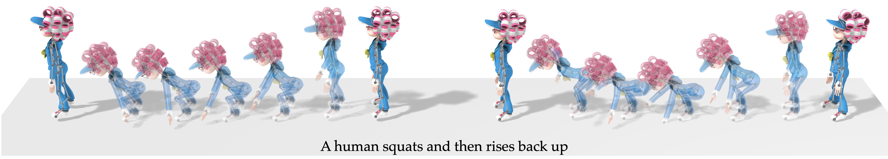
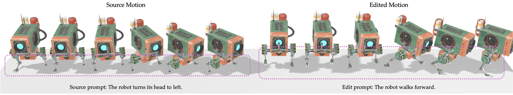
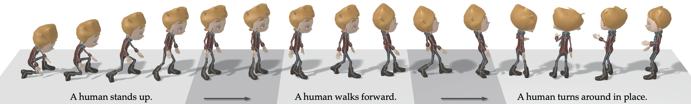

<h1 align="center">UniMate</h1>

<p align="center"><b>One Unified Model to Animate Diverse Skeletons</b></p>

<p align="center">
  <a href="https://linzhanmou.com/unimate/"></a>
  <a href="https://arxiv.org/abs/2609.05415"></a>
  <a href="https://linzhanmou.com/unimate/interactive.html"></a>
  <a href="https://huggingface.co/datasets/Linzhan/UniML3D"></a>
  <a href="https://huggingface.co/Linzhan/UniMate"></a>
</p>

<p align="center">
  <a href="https://linzhanm.github.io/">Linzhan Mou</a> ·
  <a href="https://jiahuilei.com/">Jiahui Lei</a> ·
  <a href="https://frank-zy-dou.github.io/">Zhiyang Dou</a> ·
  <a href="https://chenyue-cai.com/">Chenyue Cai</a> ·
  <a href="https://chaoyuesong.github.io/">Chaoyue Song</a> ·
  <a href="https://www.cs.princeton.edu/~af/">Adam Finkelstein</a> ·
  <a href="https://www.cs.princeton.edu/~smr/">Szymon Rusinkiewicz</a>
</p>

<p align="center">Princeton · UC Berkeley · MIT · NTU</p>

<div align="center">
    
</div>

---

## 🔥 News

- **[2026-10-05]** **Bring your own rig**: [`rig_preprocess`](data_process/rig_preprocess/) turns any rigged GLB / glTF / FBX, animated or not, into an asset UniMate can animate, with a review step for its joint labels and facing; the sampler takes dataset skeletons and your own assets by reference. [UniML3D](https://huggingface.co/datasets/Linzhan/UniML3D) adds training-ready features, canonical rest-pose meshes and generic / detailed captions. 🛠️
- **[2026-09-27]** Preview checkpoints are released at [HuggingFace](https://huggingface.co/Linzhan/UniMate); new checkpoints will be synced there. 📦
- **[2026-09-06]** The **training and inference code** is released. 🚀
- **[2026-08-30]** The [UniML3D dataset](https://huggingface.co/collections/Linzhan/unimate) and its [data-processing pipeline](data_process/) are released. 🚀
- **[2026-08-01]** Our [Interactive Demo](https://linzhanmou.com/unimate/interactive.html) is live — browse our animation results in 3D. 🎮
- **[2026-07-18]** UniMate is accepted to SIGGRAPH Asia 2026! 🎉

## 🛠️ Environment Setup

> **🪟 Windows portable build (this fork)** — no conda needed. Run `install_unimate.ps1` (creates an isolated uv venv `unimate_env` with Python 3.10, PyTorch 2.5.1+cu124, bpy 4.0.0 and everything below, with all caches inside the project folder), then `run_unimate.ps1` (launcher menu: sampling / checkpoint download / mesh animation / portable shell). Russian version of this document: [README.ru.md](README.ru.md). **This build is inference-only** — dataset construction and training are out of its scope (see [Data & Training](#-data--training-out-of-scope-for-this-fork)).
>
> Extras of this build:
> - `tools/_hf_pycurl_download.py` — stable resumable HuggingFace downloads over pycurl with `--include`/`--exclude` filters (the `hf` CLI is not required).
> - `mcp_unimate/` — FastMCP server + CLI (`python -m mcp_unimate.server` for MCP clients, `python -m mcp_unimate sample "assets/examples/eagle" "An object flaps its wings."` for the terminal): text-to-animation on any rigged GLB, mesh animation to animated GLB/FBX via pip bpy, non-interactive rig preprocessing.
> - Windows port of the rendering stack: the GPU render lock works via fcntl/msvcrt dispatch (`data_process/utils/blender_render.py`). All POSIX shell wrappers (`scripts/*.sh`, `data_process/scripts/*.sh`) have been **removed** in this build — every pipeline stage keeps its `python -m ...` module entry point, exposed through the launcher menu and the MCP/CLI tools below.
> - See `WINDOWS_PORT_AUDIT.md` for the per-file portability audit.

Everything is installed by `install_unimate.ps1` into an isolated uv venv (`unimate_env`, Python 3.10) — no conda, no system Python: it downloads `uv`, installs a uv-managed Python, pins `setuptools<81` (required by the `Motion` git dependency's legacy build), installs PyTorch 2.5.1+cu124 and bpy 4.0.0 from their wheel indexes, and applies [`requirements.txt`](requirements.txt) with `--no-build-isolation`. Rerunning the installer is safe: a valid existing environment is kept.

## 📊 Data & Training (out of scope for this fork)

This build targets **inference only**: a released checkpoint plus your own rigged asset. The UniML3D dataset (~88 GB), the pipeline that builds it, and model training are not part of the portable workflow.

For those parts, the code and documentation remain in place: the data-processing pipeline is documented in [`data_process/README.md`](data_process/README.md) (download → export → rendering → captioning → joint annotation → feature extraction → animation), and training lives in [`unimate/training/`](unimate/training/) — launched as `accelerate launch -m unimate.training.train --config <config>` with the JSON configs in [`configs/`](configs/). Text-embedding precomputation for training runs: `python -m unimate.tools.precompute_text_emb --config <config>`.

## 📌 Note

The processed **UniML3D** dataset is [released](https://huggingface.co/datasets/Linzhan/UniML3D). Its captions were **re-processed** for this release, so they do not necessarily match the prompts shown on the project page or in the paper. See the released caption style in [Truebones](https://huggingface.co/datasets/Linzhan/UniML3D/blob/main/export/truebones/motion_captions.json) · [Mixamo](https://huggingface.co/datasets/Linzhan/UniML3D/blob/main/export/mixamo/motion_captions.json) · [Objaverse](https://huggingface.co/datasets/Linzhan/UniML3D/blob/main/export/objaverse/motion_captions.json). New prompts start with "An object" to generalize across objects.

UniMate is an **early step** toward text-to-animation for any skeleton, and many motions and skeletons **still fail**. We believe that scaling up training data — **distilled from agents or generated from videos** — is a promising direction to close this gap. If you run into failure cases, please open an issue or contact us; they help us improve.

## 🎬 Inference

Given a rigged 3D asset and a text prompt, UniMate generates articulated motion for arbitrary skeletons in real time — with no per-skeleton retraining and no test-time optimization.

**1. Get a model.** Download the [released checkpoint](https://huggingface.co/Linzhan/UniMate) with the pycurl downloader (configuration, normalization statistics, latest checkpoint — nothing else, ~1.1 GB):

```bash
python tools/_hf_pycurl_download.py Linzhan/UniMate outputs --repo-type model \
    --include "unimate_uniml3d_f60_v3/config.json" \
    --include "unimate_uniml3d_f60_v3/dataset_stats.npy" \
    --include "unimate_uniml3d_f60_v3/checkpoints/checkpoint_step_150000.pt"
```

or use the output directory of your own training run.

**2. Animate your rigged asset.** [`rig_preprocess`](data_process/rig_preprocess/README.md) turns a rigged GLB / glTF / FBX, animated or not, into an asset directory that `--asset` takes (on this build: the `preprocess_rig` MCP tool or `python -m mcp_unimate rig <input.glb> <out_dir>`). Three assets processed this way are in [`assets/examples`](assets/examples): a Unitree Go2 quadruped, an eagle and a shark:

```bash
python -m unimate.inference.sample --exp_dir outputs/unimate_uniml3d_f60_v3 --asset assets/examples/eagle \
    --prompt "An object flaps its wings." "An object strikes forward." --output_dir outputs/samples/custom
python -m data_process.mesh_animation.sample_manifest outputs/samples/custom --skip_invalid   # the mesh, animated
```

`--asset <refs> --prompt <prompts>` samples every prompt on every asset without a file. Motions are written to `--output_dir` (default `<exp_dir>/samples`); runs into the same directory add to it, and `python -m data_process.mesh_animation.sample_manifest <dir> --skip_invalid` lists the (motion, rig, cond) jobs that drive them (or use the `animate_manifest` MCP tool). Mesh driving checks first that motion, conditioning and mesh share one joint order.

<details>
<summary><b>Prompting</b></summary>

Prompts matter. Write short captions in the style of the training captions: start with "An object" and describe one motion, not the character ("An object flaps its wings.", not "A blue parrot flaps its wings in the sky."). The closer a prompt is to that style, the better it is followed. Samples vary, so generate several (`--num_repetitions`) and try a few phrasings. `--cfg_scale` (default 3) sets how strongly the prompt is followed: raise it (5 to 7) when a prompt is ignored, lower it for smoother, calmer motion.

</details>

## 🎨 Applications

The same trained model does three more tasks with no extra training. Each is replacement-style sampling: part of the motion is pinned to a known signal and the flow ODE denoises only the rest at every step, so the constraint holds exactly rather than being encouraged by a loss.

### Motion in-betweening

Hold chosen keyframes at their ground truth and generate the transitions between them.

<div align="center">
    
</div>

<details>
<summary><b>How to run it</b></summary>

`--keep_frames` takes signed indices (negatives count back from the generation window), so `"0,-1"` fills in everything between a clip's first and last pose.

```json
{ "mixamo-Air_Squat-000": "An object squats and then stands up." }
```

```bash
KEEP_FRAMES="0,-1" python -m unimate.inference.sample \
    --exp_dir outputs/unimate_uniml3d_f60_v3 --inbetween cases.json
```

</details>

### Text-guided motion editing

Hold chosen joints at their ground-truth motion for every frame and regenerate the rest under a new prompt — keep what should stay, re-animate the rest.

<div align="center">
    
</div>

<details>
<summary><b>How to run it</b></summary>

`--keep_joints` matches case-insensitively against either the rig's own bone names or the cleaned vocabulary.

```json
{ "mixamo-Cocky_Head_Turn-000": "An object walks forward." }
```

```bash
KEEP_JOINTS="Neck,Head" python -m unimate.inference.sample \
    --exp_dir outputs/unimate_uniml3d_f60_v3 --motion_edit cases.json
```

</details>

### Motion expansion

Chain several prompts into one long motion. The first segment is generated freely; every later one pins its first few frames to the previous segment's tail, and the segments are stitched at the seam.

<div align="center">
    
</div>

<details>
<summary><b>How to run it</b></summary>

Test-case values become *lists* of prompts, one per segment; `--expand_overlap` sets how many frames consecutive segments share.

```json
{ "mixamo-sequence": ["An object stands up.", "An object walks forward.", "An object turns around in place."] }
```

```bash
EXPAND_OVERLAP=10 python -m unimate.inference.sample \
    --exp_dir outputs/unimate_uniml3d_f60_v3 --motion_expand cases.json
```

</details>

<details>
<summary><b>Shared behaviour</b></summary>

Each mode writes into its own subdirectory of `--output_dir` (`inbetween/`, `motion_edit/`, `motion_expand/`) alongside a small JSON recording the constraint that produced it.

In-betweening and editing clamp against a real clip, so their test-case keys must be `<object_type>-<clip_id>` naming a clip on disk: a dataset clip under `dataset/features/<dataset>/motions/`, or one of a `rig_preprocess` asset saved with `--save_clips`; that clip's motion is saved beside the result as `<case_id>-gt_rep_<r>-<i>.npy` for side-by-side comparison. `--gt_start_frame` pins which window of the clip is used instead of a random one. Editing trims both the sample and the GT to the clip's true length, while in-betweening generates the full window and trims only the GT — so align the two on frame 0 rather than assuming equal lengths. All three modes need `--cfg_scale > 1.0` and are mutually exclusive with each other.

</details>

## 📝 Citation

If you find UniMate useful in your research, please consider citing our work:

```bibtex
@article{mou2026unimate,
  title   = {UniMate: One Unified Model to Animate Diverse Skeletons},
  author  = {Mou, Linzhan and Lei, Jiahui and Dou, Zhiyang and Cai, Chenyue and Song, Chaoyue and Finkelstein, Adam and Rusinkiewicz, Szymon},
  journal = {arXiv preprint arXiv:2609.05415},
  year    = {2026}
}
```

## ⚖️ License

The code in this repository is released under the [MIT License](LICENSE). The released checkpoints are under [CC BY-NC 4.0](https://huggingface.co/Linzhan/UniMate/blob/main/LICENSE); see the [model card](https://huggingface.co/Linzhan/UniMate) for details.

The datasets remain governed by the licenses of their original sources: the [Mixamo](https://www.mixamo.com/) assets by Adobe's Mixamo terms of use, the [Objaverse-XL](https://objaverse.allenai.org/) assets by the license attached to each original object, and the Truebones ZOO motions by [Truebones](https://truebones.com)' commercial license. Please review and comply with the respective source licenses before using the data.

## 🤝 Acknowledgement

We thank the authors of [AnyTop](https://github.com/Anytop2025/Anytop) for open-sourcing their codebase, on which parts of this repository build. We thank [@chutch1122](https://github.com/chutch1122) for suggesting several captions per clip, which led to the normal, generic and detailed captions of UniML3D.
