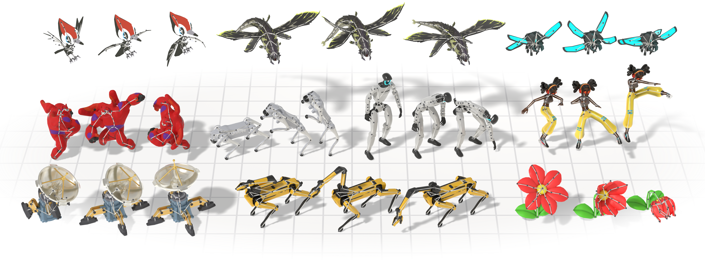

<h1 align="center">UniMate (портативная сборка для Windows)</h1>

<p align="center"><b>Анимация любой риггед 3D-модели по текстовому описанию — без риггинга, ретаргета и обучения</b></p>

<p align="center">Русская версия документации. English: <a href="README.md">README.md</a></p>

<p align="center">
  <b>Портативная сборка для Windows и адаптация с Linux:</b>
  <a href="https://github.com/Methelina">Methelina</a> aka <b>Soror L.'.L.'.</b>
</p>

<div align="center">
    
</div>

---

## 🎬 Что такое UniMate?

UniMate — это ИИ-модель, которая **создаёт скелетную анимацию по текстовому описанию**. Вы даёте ей риггед 3D-модель — персонажа, животное, робота, любое существо — и фразу вроде *"An object flaps its wings."* («объект машет крыльями»). На выходе — скелетное движение: модель ходит, бежит, танцует, атакует или плывёт.

Чем это отличается от привычных инструментов анимации:

- **Не нужен ретаргет.** Классический пайплайн требует ретаргет-проход (или полный перериг) на каждого нового персонажа. UniMate обучался на 7 430 разных скелетах — бипеды, квадрупеды, птицы, рыбы, насекомые, змеи, даже шарнирные объекты — и управляет невиданным ригом напрямую, только по структуре его костей.
- **Не нужны навыки аниматора.** «Вход» — обычное предложение на английском. Нужен цикл ходьбы? *"An object walks forward."* Боевое движение? *"An object attacks forward."*
- **Генерация в реальном времени.** Движение занимает секунды на одной потребительской GPU-карте, а не часы в пакетах 3D-графики.
- **Три дополнительных режима бесплатно** (та же модель, без дообучения): заполнить промежуток между ключевыми кадрами (**in-betweening**), зафиксировать выбранную часть тела и перерисовать остальное под новый промпт (**editing**), сшить несколько промптов в один длинный дубль (**expansion**).

**Кому это нужно:** 3D-художникам, которым нужно быстрое базовое движение; геймдеву для прототипирования движения существ; превизу и машиниме; моддерам — всем, у кого есть риггед-модель, и нужно, чтобы она двигалась.

**Что появляется на диске:** MP4-превью, которые можно смотреть сразу; сырые скелетные движения (`.npy`); и — ещё одной командой — ваша модель **анимированной, в GLB + FBX**, готовой для Blender, Unity, Unreal или Godot.

## ✅ Что нужно

| Требование | Детали |
|---|---|
| Windows 10/11 x64 | всё портативно — без прав администратора, без установки в систему |
| NVIDIA GPU | 6 ГБ VRAM комфортно; 4 ГБ работает с более короткими батчами |
| ~15 ГБ на диске | среда (~8 ГБ) + чекпоинт модели (~1,1 ГБ) + рабочее место |
| Интернет | один раз — для первого скачивания среды и модели |
| Риггед-модель | GLB / glTF / FBX со скелетом (арматорой); скин-меш необязателен |

**Не** нужно: Python, conda, git, пакет 3D-графики, навыки программирования.

## ⚠️ Честные ограничения

- Модель — ранний исследовательский шаг: **многие движения и скелеты всё ещё не получаются**. Жираф, танцующий брейк-данс, — не выйдет; волк, бегущий рысью, — пожалуйста.
- Промпты должны быть короткими и обобщёнными — *"An object flaps its wings."*, а не *"Величественный золотой орёл парит в закатном небе"*. Чем ближе к стилю обучающих подписей, тем лучше результат.
- Анимация — FK на заданном скелете: без мимики, без хореографии пальцев, без физического взаимодействия.
- Релизные веса модели — **CC BY-NC 4.0: только некоммерческое использование**. Код — MIT.

## 🛠️ Установка (два шага, один раз)

1. Скачайте или склонируйте эту папку на любой диск.
2. Правый клик на `install_unimate.ps1` → **«Выполнить с помощью PowerShell»** (или `pwsh -File install_unimate.ps1`). Подождите — первый запуск скачивает среду и самый долгий.

Это всё. Установщик собирает полностью изолированную среду **внутри папки проекта** (Python, PyTorch с CUDA, Blender в виде библиотеки) — в сам Windows ничего не устанавливается, и папку можно потом перенести на другой диск. Повторный запуск установщика безопасен.

## 🎮 Как пользоваться

### Простой путь: меню лаунчера

Запустите `run_unimate.ps1` (правый клик → «Выполнить с помощью PowerShell»). Появится нумерованное меню из трёх групп. Почти в каждом пункте можно просто жать **Enter** — тогда подставляется разумное значение по умолчанию.

---

**1 — Генерация движения** (ваш ассет + текстовый промпт). Основной пункт. Спросит: путь к ассету (Enter — встроенный орёл `assets/examples/eagle`; сюда же можно вписать подготовленный риг из пункта 6, например `outputs/rig/my_hero`), промпт на английском, число вариантов и «привязку к промпту».
> Пример заполнения: ассет `assets/examples/shark`, промпт `An object swims and turns around.`, вариантов `3`, привязка `3`.
> Результат: превью в `outputs\samples_custom\animations\*.mp4`, движения в `motions\*.npy`. После генерации спросит «Animate the mesh now? (y/N)» — ответ `y` сразу наденет движения на модель и сохранит GLB+FBX.

**2 — Пакетная генерация** (несколько сцен из JSON). Берёт список сцен «ассет + промпт» из файла. Готовый пример: `assets\examples\examples.json` (Garfield танцует, Gundam пинает, Баймакс ходит…).
> Пример заполнения: путь `assets\examples\examples.json`, остальное — Enter.
> Свой файл — это JSON-список вида `[{"asset": "outputs/rig/my_hero", "id": "hero-walk", "prompt": "An object walks forward."}]`.

**3 — Редактирование движения (motion editing).** Фиксирует выбранные суставы на их текущем движении и перегенерирует остальное под новым промптом. Нужно: JSON с **именами реальных клипов** (клипы дают датасет-ассеты или риг, подготовленный с сохранением клипов), и список суставов.
> Пример заполнения: JSON `cases.json` с содержимым `{"mixamo-Cocky_Head_Turn-000": "An object walks forward."}`, суставы `Neck,Head`.
> Результат: `outputs\samples_edit\motion_edit\` — рядом с каждым результатом лежит исходный клип для сравнения.

**4 — In-betweening (промежуточные кадры).** Фиксирует выбранные ключевые кадры и дорисовывает движение между ними. Указываются индексы кадров; отрицательные считаются с конца.
> Пример заполнения: JSON `cases.json` вида `{"mixamo-Air_Squat-000": "An object squats and then stands up."}`, кадры `0,-1` (первая и последняя поза — всё между ними дорисуется).
> Результат: `outputs\samples_inbetween\inbetween\`.

**5 — Motion expansion (сшитый длинный дубль).** Несколько промптов превращаются в одно непрерывное движение: первый сегмент генерируется свободно, каждый следующий начинаетсья с «хвоста» предыдущего.
> Пример заполнения: JSON `cases.json` вида `{"mixamo-sequence": ["An object stands up.", "An object walks forward.", "An object turns around in place."]}`, перекрытие `10` кадров.
> Результат: `outputs\samples_expand\motion_expand\`.

**6 — Подготовка своего рига.** Единожды превращает ваш GLB/glTF/FBX (любой, даже без анимаций) в ассет UniMate: читает скелет, автоматически подписывает суставы, строит `cond.npy` и канонический меш.
> Пример заполнения: вход `C:\models\my_hero.glb`, выход — Enter (сам подставит `outputs/rig/my_hero`).
> После этого используйте `outputs/rig/my_hero` как ассет в пунктах 1–5. Хотите контролировать подписи суставов — запустите без `--no_review` из командной строки (см. `data_process/rig_preprocess/README.ru.md`).

**7 — Анимация меша (motions → GLB + FBX).** Берёт каталог с результатами генерации и прогоняет каждое движение по мешу его ассета через Blender: на выходе анимированные GLB и FBX для Blender / Unity / Unreal / Godot.
> Пример заполнения: `outputs\samples_custom`.
> Результат: `outputs\samples_custom\animated\<имя>.glb` и `.fbx`. Несовместимые движения пропускаются с сообщением.

**8 — Скачивание модели.** Один раз докачивает инференс-набор (~1,1 ГБ): конфиг, статистику нормализации и последний чекпоинт. Устойчивая докачка: обрыв связи не начинается с нуля.

**9 — Тренировка**, **10 — Предвычисление эмбеддингов** — для исследователей (нужен датасет UniML3D, в инференс-сценарии не требуются). **11 — Python-оболочка** портативной среды для ручных сценариев.

Перед меню лаунчер сам выбирает GPU с максимумом свободной памяти и изолирует все кэши в папку проекта — ничего не пишется в `C:\Users\...`.

### Типичная первая сессия

```
run_unimate.ps1
  → 8  (скачать модель, один раз)
  → 1  (ассет: Enter — орёл, промпт: An object flaps its wings., вариантов 3)
  → на вопрос «Animate the mesh now?» — y
  → открыть outputs\samples_custom\animations\*.mp4 и outputs\samples_custom\animated\*.glb
```

### Как писать промпты, чтобы работало

Начинайте с **"An object"** и описывайте **одно движение** (промпты — на английском, именно на них модель обучалась):

| Работает | Не работает |
|---|---|
| An object walks forward. | A brave knight walks to the castle. |
| An object flaps its wings. | A golden eagle soars in the sunset. |
| An object attacks forward. | Fight me! |

Генерируйте 3–5 вариантов и выбирайте лучший дубль. Если модель игнорирует промпт — поднимите «привязку» до 5–7; если движения дёрганые — опустите до 2.

## 🤖 Для ИИ-агентов и продвинутых: FastMCP + CLI

Весь инструментарий также доступен как FastMCP-сервер (`mcp_unimate/server.py`) — зарегистрируйте его один раз в своём MCP-клиенте (Kilo, Claude Desktop, …) и управляйте UniMate разговором:

```json
"unimate": {
  "type": "local",
  "command": [
    "K:\\work\\AI\\UniMate\\unimate_env\\Scripts\\python.exe",
    "-m", "mcp_unimate.server"
  ],
  "enabled": true,
  "timeout": 3600000
}
```

Инструменты: `sample_animation` (текст → движение на любом риге), `animate_motion` (движение → анимированный GLB/FBX через Blender), `preprocess_rig` (подготовка своего GLB/FBX), `animate_manifest`, `list_examples`, `list_checkpoints`, `download_checkpoint`. Те же операции доступны из терминала: `python -m mcp_unimate sample assets/examples/shark "An object swims and turns around." --reps 3`.

## 📦 Данные и тренировка (вне рамок форка)

Эта сборка — только инференс: чекпоинт + собственный риггед-ассет. Датасет UniML3D (~88 ГБ), пайплайн его построения и тренировка модели в неё не входят.

Для этих частей код и документация на месте: пайплайн обработки данных описан в [`data_process/README.md`](data_process/README.md) (загрузка → экспорт → рендеринг → подписи → разметка суставов → извлечение признаков → анимация), тренировка — в [`unimate/training/`](unimate/training/), запуск: `accelerate launch -m unimate.training.train --config <config>`, конфиги в [`configs/`](configs/). Предвычисление текстовых эмбеддингов для тренировочных прогонов: `python -m unimate.tools.precompute_text_emb --config <config>`.

## 📌 Примечания

UniMate — **ранний шаг** к text-to-animation для произвольных скелетов, и многие движения и скелеты **всё ещё не удаются**. Случаи отказов помогают улучшению — заводите issues или пишите авторам оригинала.

## 📝 Цитирование

Если UniMate полезен в вашем исследовании, процитируйте работу оригинала:

```bibtex
@article{mou2026unimate,
  title   = {UniMate: One Unified Model to Animate Diverse Skeletons},
  author  = {Mou, Linzhan and Lei, Jiahui and Dou, Zhiyang and Cai, Chenyue and Song, Chaoyue and Finkelstein, Adam and Rusinkiewicz, Szymon},
  journal = {arXiv preprint arXiv:2609.05415},
  year    = {2026}
}
```

## ⚖️ Лицензия

Код репозитория — [MIT License](LICENSE). Релизные чекпоинты — [CC BY-NC 4.0](https://huggingface.co/Linzhan/UniMate/blob/main/LICENSE) (только некоммерческое использование); детали — в карточке модели.

Портативная сборка для Windows, инструменты установки и запуска, FastMCP-мост и адаптация с Linux выполнены **Methelina aka Soror L.'.L.'.'**.

Датасеты подчиняются лицензиям исходных источников: ассеты [Mixamo](https://www.mixamo.com/) — условия Adobe Mixamo, объекты [Objaverse-XL](https://objaverse.allenai.org/) — лицензия каждого исходного объекта, движения Truebones ZOO — коммерческая лицензия [Truebones](https://truebones.com). Перед использованием данных проверьте и соблюдайте соответствующие лицензии.

## 🤝 Благодарности

Авторы [AnyTop](https://github.com/Anytop2025/Anytop) за открытую кодовую базу, на которой частично построен этот репозиторий, и @chutch1122 за идею нескольких подписей на клип, из которой выросли обычная, общая и детальная подписи UniML3D.
